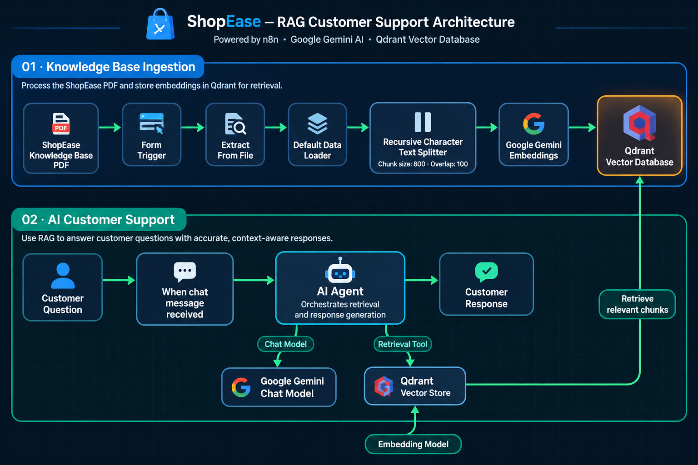

# ShopEase — AI-Powered RAG Customer Support Assistant

An AI-powered e-commerce customer support chatbot built using **n8n, Google Gemini AI, and Qdrant Vector Database**. It uses Retrieval-Augmented Generation (RAG) to provide accurate, context-aware answers based on a business knowledge base.

## 🚀 Project Overview

ShopEase is a fictional e-commerce business prototype designed to automate repetitive customer support queries.

The chatbot retrieves relevant information from a PDF-based knowledge base and generates responses using Google Gemini AI.

It helps customers get quick answers about products, pricing, shipping, returns, and refunds without manually searching through business documents.

## 🎯 Business Problem

E-commerce businesses frequently receive repetitive customer queries related to:

- Product prices and availability
- Shipping charges and delivery timelines
- Return and refund policies
- Damaged product reporting

Handling these queries manually can consume time and delay customer support.

## 💡 Proposed Solution

ShopEase uses a RAG-based chatbot that:

- Retrieves relevant information from a business knowledge base.
- Uses Google Gemini AI to generate natural-language responses.
- Provides answers grounded in retrieved information.
- Avoids making up unsupported policies or product details.
- Politely informs customers when information is unavailable.

## ✨ Key Features

- **RAG Architecture:** Retrieves relevant information before generating answers.
- **PDF Knowledge Base:** Uses business documentation as its information source.
- **AI-Powered Responses:** Uses Google Gemini AI.
- **Vector Search:** Stores and retrieves document embeddings using Qdrant.
- **Context-Aware Retrieval:** Uses relevant document chunks to answer queries.
- **Hallucination Control:** Instructs the chatbot to avoid unsupported answers.
- **Public Chat Interface:** Allows users to interact with the chatbot through a chat URL.

## 🏗️ System Architecture

The project consists of two independent n8n workflows connected through a shared Qdrant Vector Database.



### Workflow Overview

**1. Knowledge Base Ingestion**

PDF → Form Trigger → Extract From File → Default Data Loader → Recursive Character Text Splitter → Google Gemini Embeddings → Qdrant Vector Database.

**2. AI Customer Support**

Customer Question → Chat Trigger → AI Agent → Google Gemini Chat Model + Qdrant Retrieval Tool → Customer Response.

The AI Agent retrieves relevant information from Qdrant and uses Google Gemini to generate context-aware responses.

## ⚙️ Workflow Explanation

### 1. Knowledge Base Ingestion

**Workflow:** `01 - ShopEase Knowledge Base`

This workflow processes business documentation and stores it in Qdrant.

Steps:

1. Form Trigger receives the knowledge base PDF.
2. Extract From File extracts text from the PDF.
3. Default Data Loader prepares the extracted text.
4. Recursive Character Text Splitter divides text into smaller chunks.
5. Google Gemini Embeddings converts chunks into vector embeddings.
6. Qdrant Vector Store stores the embeddings for retrieval.

**Text splitting configuration:**
- Chunk Size: 800
- Chunk Overlap: 100

### 2. AI Customer Support Chatbot

**Workflow:** `02 - ShopEase AI Customer Support`

This workflow handles customer questions and generates knowledge-based responses.

Steps:

1. Customer sends a message through the n8n Chat Trigger.
2. AI Agent receives the question.
3. Qdrant Vector Store retrieves relevant knowledge.
4. Google Gemini Chat Model generates a response using the retrieved information.
5. The chatbot returns the answer to the customer.

## 🧰 Tech Stack

| Technology | Purpose |
|---|---|
| n8n | Workflow automation |
| Google Gemini AI | LLM and embeddings |
| Qdrant | Vector database |
| RAG | Knowledge-grounded responses |
| PDF | Business knowledge source |
| Recursive Character Text Splitter | Document chunking |

## 🧪 Testing

The chatbot was manually tested with four representative queries.

| Test Case | Expected Result | Status |
|---|---|---|
| Smart Watch price | ₹2,499 | Passed |
| Standard shipping time | 3–5 business days | Passed |
| Return and refund policy | Relevant policy information | Passed |
| Smart Watch warranty | Information unavailable fallback | Passed |

**Manual smoke test result: 4/4 passed.**

## 🌐 Live Demo

Try the ShopEase AI Customer Support chatbot:

[Open Live Chatbot](https://dharmik-n8n.app.n8n.cloud/webhook/762d37b8-7f6f-4e07-ba84-9e7874df1858/chat)

*Note: This is a learning and portfolio prototype using fictional business information.*

## 📸 Screenshots

Project screenshots are available in the `screenshots/` directory.

| Screenshot | Description |
|---|---|
| `system-architecture.png` | Complete RAG System Architecture |
| `workflow-1.png` | Knowledge Base Ingestion Workflow |
| `workflow-2.png` | AI Customer Support Workflow |
| `chatbot-demo.png` | Live Chatbot Interface |

## 📁 Repository Structure

```text
ShopEase-RAG-Customer-Support/
│
├── README.md
│
├── workflows/
│   ├── 01-knowledge-base-ingestion.json
│   └── 02-ai-customer-support.json
│
├── knowledge-base/
│   └── ShopEase-Knowledge-Base.pdf
│
└── screenshots/
    ├── system-architecture.png
    ├── workflow-1.png
    ├── workflow-2.png
    └── chatbot-demo.png
```

## 🔧 Setup Instructions

1. Clone the repository:

   ```bash
   git clone https://github.com/dharmiksoni15/ShopEase-RAG-Customer-Support.git
   ```

2. Open your n8n instance.

3. Import the workflow JSON files from the `workflows/` directory.

4. Configure your Google Gemini and Qdrant credentials in n8n.

5. Create a Qdrant collection named `shopease-knowledge-base` with:
   - Vector Size: `3072`
   - Distance: `Cosine`

6. Execute the Knowledge Base Ingestion workflow to upload and process the PDF.

7. Activate the AI Customer Support workflow and test it using the chat interface.

*Important: Credentials are not included in the repository. Configure your own credentials before running the workflows.*

## 🔮 Future Enhancements

- Live order tracking integration
- Customer authentication
- Human support escalation
- Gmail-based support ticket automation
- Multi-document knowledge base management
- Improved response evaluation and testing

## 📚 Learning Outcomes

Through this project, I gained practical experience with:

- Building RAG-based AI applications.
- Designing multi-workflow automation in n8n.
- Understanding embeddings and vector databases.
- Implementing document ingestion and retrieval.
- Connecting LLMs with external knowledge sources.
- Testing AI responses against business information.

## 👨‍💻 Author

**Dharmik Soni**

MCA Student | Full-Stack MERN Developer | Exploring AI Automation & Agentic AI

- GitHub: [@dharmiksoni15](https://github.com/dharmiksoni15)
- LinkedIn: [Dharmik Soni](https://linkedin.com/in/dharmik-soni15/)
- Portfolio: [dharmiksoni-portfolio.netlify.app](https://dharmiksoni-portfolio.netlify.app/)

---

⭐ If you find this project useful, consider giving it a star!
